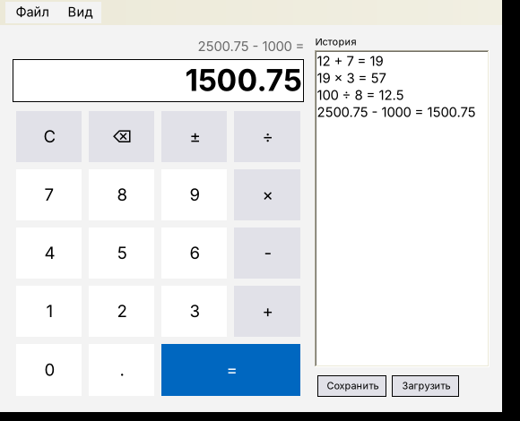
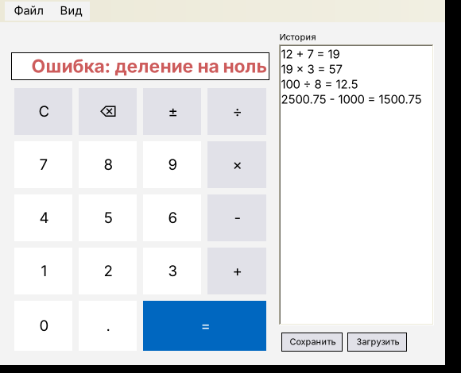
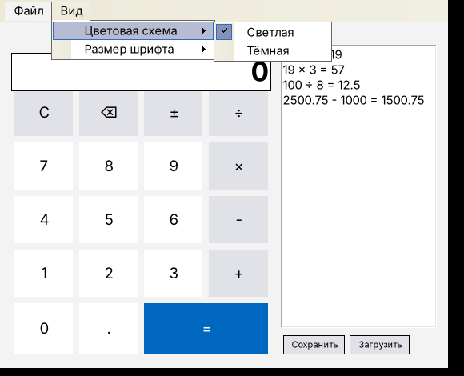
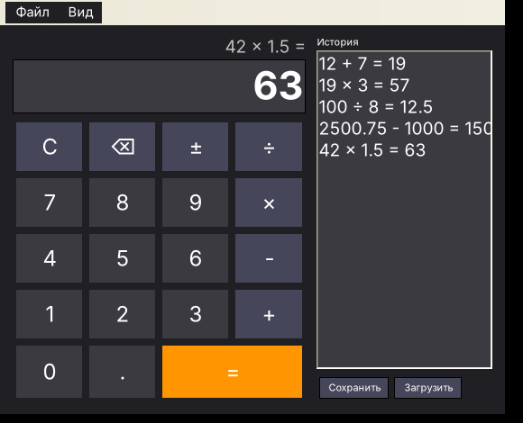

# Кейс 3. Калькулятор (Windows Forms)

Проект Windows Forms на C# (.NET 8). Открыть `Calculator.sln` в Visual Studio 2022 и запустить проект `Calculator`.

## Что реализовано

1. Проект Windows Forms Application.
2. На форме кнопки цифр 0-9, операции + - × ÷, кнопки `=` и `C`, а еще `.`, `±` и `⌫` (стереть цифру).
3. У всех кнопок есть обработчики событий (`OnButtonClick` -> `HandleInput`).
4. Сами операции считаются в классе `CalculatorEngine`.
5. Можно считать подряд: `2 + 3 × 4 =` дает 20, результат прошлой операции идет в следующую. Повторное `=` повторяет последнюю операцию. Над дисплеем видно текущее выражение.
6. Обработка ошибок: деление на ноль, переполнение, слишком длинное число (больше 16 цифр), вторая точка в числе, некорректное значение при загрузке из файла.
7. Проверка: проект `Calculator.Tests` прогоняет 20 проверок с разными числами и операциями (`dotnet run --project Calculator.Tests`).
8. История вычислений справа. Ее можно сохранить в txt файл (Файл -> Сохранить, Ctrl+S) и потом загрузить обратно (Ctrl+O). Двойной щелчок по строке истории подставляет результат на дисплей.
9. Доп. опция: меню Вид -> Цветовая схема (светлая/темная) и Вид -> Размер шрифта.

Также можно вводить с клавиатуры: цифры, + - * /, Enter или =, Backspace, Esc (очистка).

## Скриншоты

