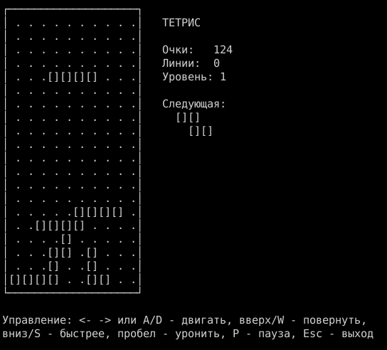
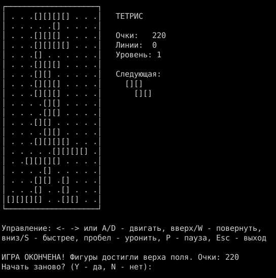

# Кейс 4. Тетрис (консольное приложение C#)

Открыть `Tetris.sln` в Visual Studio 2022 и запустить проект `Tetris` (или `dotnet run --project Tetris`).

## Управление

- влево / вправо (или A / D) - двигать фигуру
- вверх (или W) - повернуть
- вниз (или S) - ускорить падение
- пробел - уронить сразу
- P - пауза, Esc - выход

## Как устроено

- `Figure` - фигура. Форма хранится матрицей битов (`int[,]`, 1 - блок, 0 - пусто). 7 стандартных фигур: I, O, T, S, Z, J, L.
- `GameField` - поле 20×10, матрица `Cells`, где 0 - пустая клетка, 1 - занятая. Тут же методы движения (`MoveLeft`, `MoveRight`, `MoveDown`, `Drop`) и вращения (`Rotate`), они проверяют, можно ли поставить фигуру в новое место. Еще фиксация фигуры (`Lock`) и удаление полных строк.
- `Renderer` - отрисовка поля в консоль: поле в рамке из линий, `[]` блок, ` .` пустое место.
- `Game` - состояние игры: текущая и следующая фигура, очки, линии, уровень.
- `Program` - основной цикл: читает клавиши, по таймеру роняет фигуру на клетку, перерисовывает поле.
- Конец игры: если новая фигура уже не помещается сверху поля (фигуры дошли до верха), выводится сообщение и вопрос, начать ли заново (Y/N).

Проект `Tetris.Tests` проверяет логику без консоли: повороты, стенки, падение, удаление строк, очки, конец игры, перезапуск.

## Скриншоты

