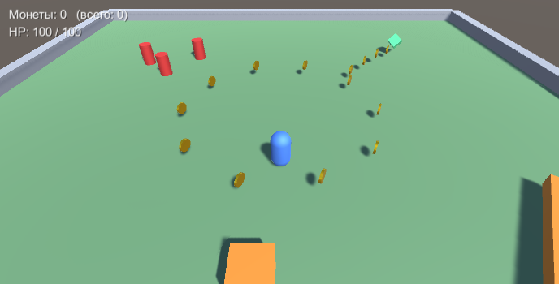
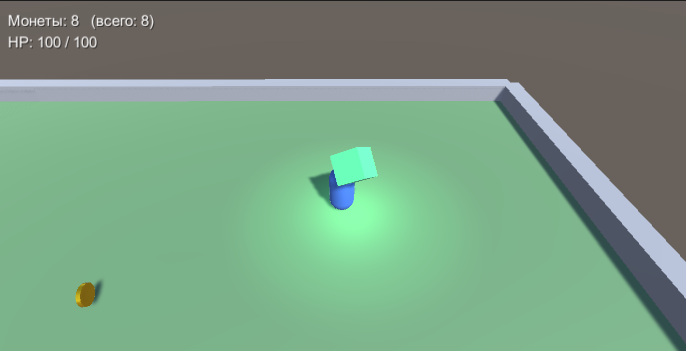
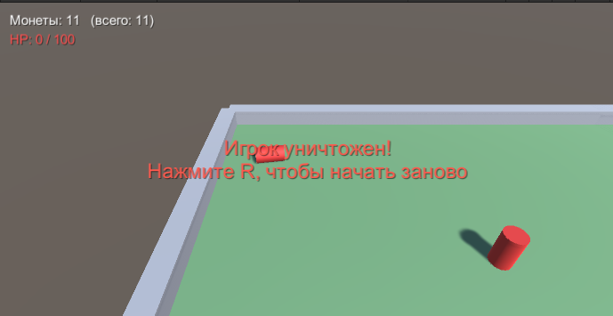

# Кейс 5. Unity

Unity 2022.3 LTS, Built-in Render Pipeline, пакет Cinemachine 2.10.

Сцена: `Assets/Case5/Scenes/Case5.unity`. Управление: WASD - ходьба, Shift - бег, пробел - прыжок, R - заново после смерти.

## Что сделано

1. **Слежение камеры за игроком.** На Main Camera стоит `CinemachineBrain`, отдельный объект `CM vcam Player` с `CinemachineVirtualCamera`. Follow и LookAt = Player, Body: Transposer (смещение 0, 9, -10, режим World Space, сглаживание), Aim: Composer.
2. **Анимация бонуса.** Объект `BonusZone` со сферическим триггером, внутри `BonusVisual` с Animator. Контроллер `Animations/Bonus.controller`: состояния Idle (медленно крутится) и Active (быстро крутится, подпрыгивает, пульсирует), параметр bool `PlayerInside`. Скрипт `BonusZone.cs` в `OnTriggerEnter` ставит `PlayerInside = true`, в `OnTriggerExit` ставит false, еще включает подсветку.
3. **Монеты и кошелек.** `Coin.cs` (крутится, при касании игрока добавляется в кошелек и пропадает с эффектом), `Wallet.cs` хранит монеты за попытку и общее количество (сохраняется в PlayerPrefs), счет выводится в UI.
4. **Препятствия.** `ExplosiveBarrel.cs`: если врезаться в бочку на скорости выше порога (бегом, с Shift), она взрывается и игрок уничтожается, если подойти медленно, бочку можно толкать. `MovingObstacle.cs`: блок ездит туда-сюда, а еще есть вращающаяся балка. При касании отнимают 20 HP и отталкивают. `Health.cs`: когда HP доходит до 0, игрок уничтожается.
5. **Частицы.** Под игроком `DustTrail` (Particle System), `PlayerTrail.cs` меняет количество частиц в зависимости от скорости. Плюс вспышки частиц при сборе монеты, взрыве и смерти (`Effects.cs`).

Сцену можно пересобрать через меню **Case5 -> Build Scene** (скрипт `Editor/Case5SceneBuilder.cs`).

## Скриншоты

